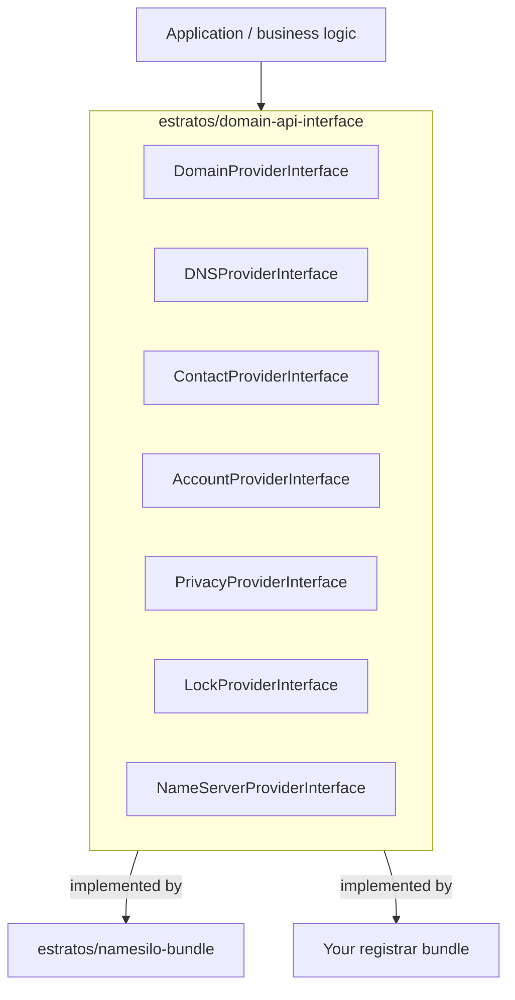

# Domain API Interface Bundle

[](https://php.net/)
[](https://symfony.com/)
[](LICENSE)

Common contracts (interfaces, DTOs, request objects and enums) for building
pluggable domain registrar integrations on top of Symfony.

## Overview

This package contains **no implementation**: it is the shared language spoken
between an application and any domain registrar adapter (NameSilo, GoDaddy,
Porkbun, Cloudflare, …). Application code depends only on these contracts, so a
registrar can be replaced without touching business logic.

- **7 provider interfaces** covering domains, DNS, contacts, account balance,
  privacy, locking and name servers (23 methods).
- **11 immutable DTOs** (`final readonly` classes) as return values.
- **8 request objects** with constructor-level validation.
- **1 backed enum** (`RecordType`) for DNS record types.
- **3 exception types** defining the error contract.

## Requirements

| Requirement | Version |
| ----------- | ------- |
| PHP | `>= 8.3` |
| Symfony HttpKernel | `^7.0` |
| Symfony DependencyInjection | `^7.0` |
| Symfony Config | `^7.0` |
| Composer | 2.x |

The three Symfony components are required because the bundle class extends
`AbstractBundle`; the full `symfony/framework-bundle` is **not** required.

## Installation

```bash
composer require estratos/domain-api-interface
```

Register the bundle in `config/bundles.php`:

```php
<?php

return [
    // ...
    Estratos\DomainApiInterface\DomainApiInterfaceBundle::class => ['all' => true],
];
```

## Architecture



The application talks to the interfaces (and their DTOs) only. Each
implementation bundle declares one service per contract, and Symfony's
autowiring selects the implementation to use.

## Package layout

```text
src/
├── Account/AccountProviderInterface.php
├── Contact/ContactProviderInterface.php
├── DNS/DNSProviderInterface.php
├── Domain/DomainProviderInterface.php
├── Lock/LockProviderInterface.php
├── NameServer/NameServerProviderInterface.php
├── Privacy/PrivacyProviderInterface.php
├── DTO/                     # 11 final readonly value objects
├── Request/                 # 8 validated request objects
├── Exception/               # ProviderException, DomainNotFoundException, RequestValidationException
├── Enum/RecordType.php
└── DomainApiInterfaceBundle.php
```

Autoloading is PSR-4: `Estratos\DomainApiInterface\` → `src/` and
`Estratos\DomainApiInterface\Tests\` → `tests/`.

## API reference

### Contracts

All provider interfaces live in `Estratos\DomainApiInterface\<Area>` and are
implementation-agnostic. Together they define 23 methods. Every method declares
`@throws ProviderException` (or a subclass) for registrar-side failures.

#### `Domain\DomainProviderInterface`

| Method | Returns |
| ------ | ------- |
| `checkAvailability(string $domain)` | `DomainAvailability` |
| `register(RegisterDomainRequest $request)` | `RegistrationResult` |
| `renew(RenewDomainRequest $request)` | `RegistrationResult` |
| `transfer(TransferDomainRequest $request)` | `RegistrationResult` |
| `getTransferStatus(string $domain)` | `TransferStatus` |
| `getInfo(string $domain)` | `DomainInfo` |
| `list()` | `DomainSummary[]` |
| `listByExpirationDate()` | `DomainSummary[]` |

#### `DNS\DNSProviderInterface`

| Method | Returns |
| ------ | ------- |
| `listRecords(string $domain, ?string $type = null)` | `DNSRecord[]` |
| `addRecord(AddDnsRecordRequest $request)` | `DNSRecord` |
| `updateRecord(UpdateDnsRecordRequest $request)` | `DNSRecord` |
| `deleteRecord(DeleteDnsRecordRequest $request)` | `bool` |

#### `Contact\ContactProviderInterface`

| Method | Returns |
| ------ | ------- |
| `list()` | `Contact[]` |
| `add(AddContactRequest $request)` | `Contact` |
| `update(UpdateContactRequest $request)` | `Contact` |
| `delete(string $contactId)` | `bool` |

#### `Account\AccountProviderInterface`

| Method | Returns |
| ------ | ------- |
| `getBalance()` | `AccountBalance` |
| `getPrices(?string $domainType = null)` | `PriceList` |

#### `Privacy\PrivacyProviderInterface`

| Method | Returns |
| ------ | ------- |
| `addPrivacy(string $domain, string $contactId)` | `PrivacyStatus` |
| `removePrivacy(string $domain)` | `PrivacyStatus` |

#### `Lock\LockProviderInterface`

| Method | Returns |
| ------ | ------- |
| `lock(string $domain)` | `LockStatus` |
| `unlock(string $domain)` | `LockStatus` |

#### `NameServer\NameServerProviderInterface`

| Method | Returns |
| ------ | ------- |
| `changeNameServers(string $domain, string[] $nameServers)` | `bool` |

### Data transfer objects

Every DTO is a `final readonly` class in `Estratos\DomainApiInterface\DTO`.
Promoted constructor properties are public; optional arguments have defaults.

| DTO | Constructor |
| --- | ----------- |
| `DomainAvailability` | `(string $domain, bool $available, ?string $reason = null, ?string $suggestedAlternative = null)` |
| `DomainInfo` | `(string $domain, string $status, DateTimeImmutable $createdAt, DateTimeImmutable $expiresAt, DateTimeImmutable $updatedAt, bool $isLocked, bool $isPrivacyEnabled, bool $isAutoRenewEnabled, string[] $nameServers, ?string $registrantContactId = null, ?string $adminContactId = null, ?string $techContactId = null, ?string $billingContactId = null)` |
| `DomainSummary` | `(string $domain, string $status, DateTimeImmutable $createdAt, DateTimeImmutable $expiresAt, bool $isLocked, bool $isPrivacyEnabled)` |
| `RegistrationResult` | `(bool $success, string $domain, ?string $orderId = null, ?DateTimeImmutable $registrationDate = null, ?DateTimeImmutable $expirationDate = null, ?string $transactionId = null, ?string $errorMessage = null)` |
| `TransferStatus` | `(string $domain, string $status, DateTimeImmutable $initiatedAt, ?DateTimeImmutable $completedAt = null, ?DateTimeImmutable $expiresAt = null, ?string $message = null)` |
| `DNSRecord` | `(string $id, string $host, RecordType $type, string $value, int $ttl, ?string $domain = null, ?int $priority = null, ?int $port = null, ?int $weight = null)` |
| `Contact` | `(string $id, string $firstName, string $lastName, string $email, string $phone, string $organization, string $address1, string $city, string $state, string $postalCode, string $country, ?string $address2 = null, ?string $fax = null, ?bool $isDefault = null)` |
| `AccountBalance` | `(float $balance, string $currency, float $available, float $reserved, ?float $creditLimit = null)` |
| `PriceList` | `(array<string, float> $prices, string $currency)` |
| `PrivacyStatus` | `(string $domain, bool $enabled, ?string $status = null, ?string $message = null)` |
| `LockStatus` | `(string $domain, bool $locked, ?string $status = null, ?string $message = null)` |

`RegistrationResult` exposes two factories so failure results do not need
placeholder values:

```php
use Estratos\DomainApiInterface\DTO\RegistrationResult;

$success = RegistrationResult::success('example.com', 'order-1', $registeredAt, $expiresAt, 'tx-1');
$failure = RegistrationResult::failure('example.com', 'registrar rejected the request');
```

Convenience helpers on the DTOs:

| DTO | Helpers |
| --- | ------- |
| `DomainAvailability` | `isAvailable()`, `isUnavailable()` |
| `DomainInfo` | `isActive()`, `isExpired()`, `daysUntilExpiration()`, `isLocked()`, `isPrivacyEnabled()`, `hasCustomNameServers()` |
| `DomainSummary` | `isActive()`, `isExpired()` |
| `RegistrationResult` | `isSuccess()`, `isFailure()` |
| `TransferStatus` | `isPending()`, `isCompleted()`, `isFailed()`, `isCancelled()` |
| `DNSRecord` | `isA()`, `isAAAA()`, `isCNAME()`, `isMX()`, `hasPriority()` |
| `Contact` | `getFullName()`, `getFullAddress()` |
| `AccountBalance` | `isPositive()`, `isNegative()`, `hasSufficientFunds(float $amount)` |
| `PriceList` | `getPrice(string $tld)`, `getPricesByCategory(string $category)` |
| `PrivacyStatus` | `isEnabled()`, `isDisabled()` |
| `LockStatus` | `isLocked()`, `isUnlocked()` |

`DomainInfo` and `DomainSummary` compare `status` case-insensitively against
`STATUS_ACTIVE` (`'active'`). `TransferStatus` exposes the canonical values
`STATUS_PENDING`, `STATUS_COMPLETED`, `STATUS_FAILED` and `STATUS_CANCELLED`, and
its helpers ignore case and surrounding whitespace.

### Request objects

Request objects are `final readonly` and validate their input in the
constructor, throwing `RequestValidationException` before any API call is made.
That exception extends `\InvalidArgumentException`, so existing catch blocks keep
working.

| Request | Required | Optional | Validation |
| ------- | -------- | -------- | ---------- |
| `RegisterDomainRequest` | `domain`, `years`, `contactId` | `private`, `autoRenew`, `nameserver1` … `nameserver4` | `years` 1–10; `domain` and `contactId` non-empty |
| `RenewDomainRequest` | `domain`, `years` | — | `years` 1–10; `domain` non-empty |
| `TransferDomainRequest` | `domain`, `authorizationCode` | `years = 1`, `private`, `autoRenew` | `domain` and `authorizationCode` non-empty; `years` 1–10 |
| `AddDnsRecordRequest` | `domain`, `host`, `type`, `value` | `ttl = 3600`, `priority`, `port`, `weight` | non-empty strings; `ttl` 60–86400; `priority` required for `MX`/`SRV`; `port` + `weight` required for `SRV` |
| `UpdateDnsRecordRequest` | `domain`, `recordId`, `host`, `type`, `value` | `ttl = 3600`, `priority`, `port`, `weight` | same rules as `AddDnsRecordRequest`, plus non-empty `recordId` |
| `DeleteDnsRecordRequest` | `domain`, `recordId` | — | both non-empty |
| `AddContactRequest` | `firstName`, `lastName`, `email`, `phone`, `organization`, `address1`, `city`, `state`, `postalCode`, `country` | `address2`, `fax`, `isDefault = false` | required fields non-empty; `email` must pass `FILTER_VALIDATE_EMAIL` |
| `UpdateContactRequest` | `contactId` + the `AddContactRequest` fields | `address2`, `fax`, `isDefault = false` | same rules, plus non-empty `contactId` |

### `RecordType` enum

A string-backed enum (`Estratos\DomainApiInterface\Enum\RecordType`) with 14
cases: `A`, `AAAA`, `CNAME`, `MX`, `TXT`, `NS`, `SRV`, `CAA`, `SOA`, `PTR`,
`SPF`, `DS`, `DNAME`, `LOC`.

| Helper | Semantics |
| ------ | --------- |
| `isNormal()` | `true` for `A`, `AAAA`, `CNAME`, `MX`, `TXT`, `NS` |
| `isAdvanced()` | `true` for every other case |
| `requiresPriority()` | `true` for `MX` and `SRV` |
| `requiresPort()` | `true` for `SRV` |
| `requiresWeight()` | `true` for `SRV` |

### Error handling

| Exception | Extends | When |
| --------- | ------- | ---- |
| `RequestValidationException` | `\InvalidArgumentException` | A request object received invalid input |
| `ProviderException` | `\RuntimeException` | A registrar operation failed |
| `DomainNotFoundException` | `ProviderException` | The requested domain is unknown to the registrar |

Provider implementations should translate transport/SDK errors into
`ProviderException` (or `DomainNotFoundException`) so callers can handle every
registrar the same way. Methods that return `bool` still throw on transport
failures; `false` means the operation was rejected or had no effect.

## Usage

### Implementing a provider

Implement the interfaces relevant to your registrar and return the DTOs. No
base class or trait is required.

```php
<?php

declare(strict_types=1);

namespace Acme\RegistrarBundle\Service;

use Estratos\DomainApiInterface\Domain\DomainProviderInterface;
use Estratos\DomainApiInterface\DTO\DomainAvailability;
use Estratos\DomainApiInterface\DTO\DomainInfo;
use Estratos\DomainApiInterface\DTO\DomainSummary;
use Estratos\DomainApiInterface\DTO\RegistrationResult;
use Estratos\DomainApiInterface\DTO\TransferStatus;
use Estratos\DomainApiInterface\Exception\ProviderException;
use Estratos\DomainApiInterface\Request\RegisterDomainRequest;
use Estratos\DomainApiInterface\Request\RenewDomainRequest;
use Estratos\DomainApiInterface\Request\TransferDomainRequest;

final class AcmeDomainProvider implements DomainProviderInterface
{
    public function checkAvailability(string $domain): DomainAvailability
    {
        try {
            $available = true; // call the registrar API
        } catch (\Throwable $exception) {
            throw new ProviderException('Availability check failed', 0, $exception);
        }

        return new DomainAvailability(domain: $domain, available: $available);
    }

    public function register(RegisterDomainRequest $request): RegistrationResult
    {
        // ... call the registrar API and return RegistrationResult::success(...)
        return RegistrationResult::failure($request->domain, 'not implemented');
    }

    public function renew(RenewDomainRequest $request): RegistrationResult
    {
        // ...
    }

    public function transfer(TransferDomainRequest $request): RegistrationResult
    {
        // ...
    }

    public function getTransferStatus(string $domain): TransferStatus
    {
        // ...
    }

    public function getInfo(string $domain): DomainInfo
    {
        // ...
    }

    /**
     * @return DomainSummary[]
     */
    public function list(): array
    {
        return [];
    }

    /**
     * @return DomainSummary[]
     */
    public function listByExpirationDate(): array
    {
        return [];
    }
}
```

### Using a provider

```php
<?php

declare(strict_types=1);

use Estratos\DomainApiInterface\Domain\DomainProviderInterface;
use Estratos\DomainApiInterface\Request\RegisterDomainRequest;

final class DomainRegistrationService
{
    public function __construct(
        private readonly DomainProviderInterface $domainProvider,
    ) {
    }

    public function registerDomain(string $domain, string $contactId): void
    {
        $availability = $this->domainProvider->checkAvailability($domain);

        if (!$availability->isAvailable()) {
            throw new \RuntimeException(sprintf('Domain "%s" is not available.', $domain));
        }

        $request = new RegisterDomainRequest(
            domain: $domain,
            years: 2,
            contactId: $contactId,
            private: true,
            autoRenew: true,
        );

        $result = $this->domainProvider->register($request);

        if (!$result->isSuccess()) {
            throw new \RuntimeException('Registration failed: ' . $result->errorMessage);
        }
    }
}
```

### Validation errors

Request objects fail fast, so callers can rely on constructor validation instead
of re-checking values:

```php
use Estratos\DomainApiInterface\Exception\RequestValidationException;
use Estratos\DomainApiInterface\Request\RenewDomainRequest;

try {
    $request = new RenewDomainRequest(domain: 'example.com', years: 11);
} catch (RequestValidationException $exception) {
    // "Years must be between 1 and 10"
}
```

Because `RequestValidationException` extends `\InvalidArgumentException`,
catching the SPL exception still works.

### Managing DNS records

```php
use Estratos\DomainApiInterface\DNS\DNSProviderInterface;
use Estratos\DomainApiInterface\Enum\RecordType;
use Estratos\DomainApiInterface\Request\AddDnsRecordRequest;

/** @var DNSProviderInterface $dns */
$record = $dns->addRecord(new AddDnsRecordRequest(
    domain: 'example.com',
    host: '_sip._tcp',
    type: RecordType::SRV,
    value: 'sipserver.example.com',
    ttl: 3600,
    priority: 10,
    port: 5060,
    weight: 5,
));
```

## Symfony integration

Registering the bundle is enough to make its classes available; the bundle
ships no services and no container configuration. Provider bundles register
their own services and alias the interfaces they implement.

Because the package is a set of contracts, autowiring works directly:

```yaml
# config/services.yaml
services:
    _defaults:
        autowire: true
        autoconfigure: true

    Estratos\DomainApiInterface\Domain\DomainProviderInterface: '@Acme\RegistrarBundle\Service\AcmeDomainProvider'
```

## Testing and quality tooling

```bash
composer test             # phpunit (71 tests, 201 assertions)
composer phpstan          # phpstan analyse src tests --level=max
composer php-cs-fixer     # php-cs-fixer fix --dry-run --diff
composer php-cs-fixer-fix # php-cs-fixer fix
```

The suite lives in `tests/` and is wired through `phpunit.xml.dist`
(bootstrap `vendor/autoload.php`, coverage source `src/`). Coverage is opt-in:

```bash
vendor/bin/phpunit --coverage-text
```

`requireCoverageMetadata="true"` is enabled, so every test class must declare
`#[CoversClass(...)]` (the existing tests already do).

PHPStan runs at `--level=max` and PHP-CS-Fixer enforces the ruleset in
`.php-cs-fixer.dist.php` (Symfony + PSR-12 + PHP 8.3 migration). Fixer and
PHPStan runs are expected to be clean before opening a pull request.

## Design notes and limitations

- **Status strings are provider-specific.** `TransferStatus`,
  `DomainInfo` and `DomainSummary` normalize case and whitespace before
  comparing, and expose canonical constants, but a provider that uses different
  wording (for example `TRANSFER_IN_PROGRESS`) must still map it to
  `TransferStatus::STATUS_*` itself.
- **Dates use the system clock.** `DomainInfo::isExpired()` and
  `daysUntilExpiration()` call `new DateTimeImmutable()` internally, so there is
  no clock injection for deterministic tests. `daysUntilExpiration()` is signed:
  negative once the domain has expired.
- **Money is a `float`.** `AccountBalance` and `PriceList` do not use a decimal
  or money value object; callers that need exact arithmetic must round or use
  their own type.
- **Destructive operations return `bool`.** `delete*` and `changeNameServers()`
  return `false` when the registrar rejects the operation and throw
  `ProviderException` for transport failures.
- **No container configuration ships with the bundle.** Applications only need
  to register the bundle class; providers own their service definitions.

## Contributing

1. Fork the repository and create a feature branch.
2. Make your changes, keeping the public contract backward compatible.
3. Add or update tests under `tests/` with a `#[CoversClass(...)]` attribute.
4. Run `composer test`, `composer phpstan` and `composer php-cs-fixer`.
5. Open a pull request describing the contract change.

## License

Released under the [MIT License](LICENSE).

Copyright (c) 2026 Julio Rodriguez.
